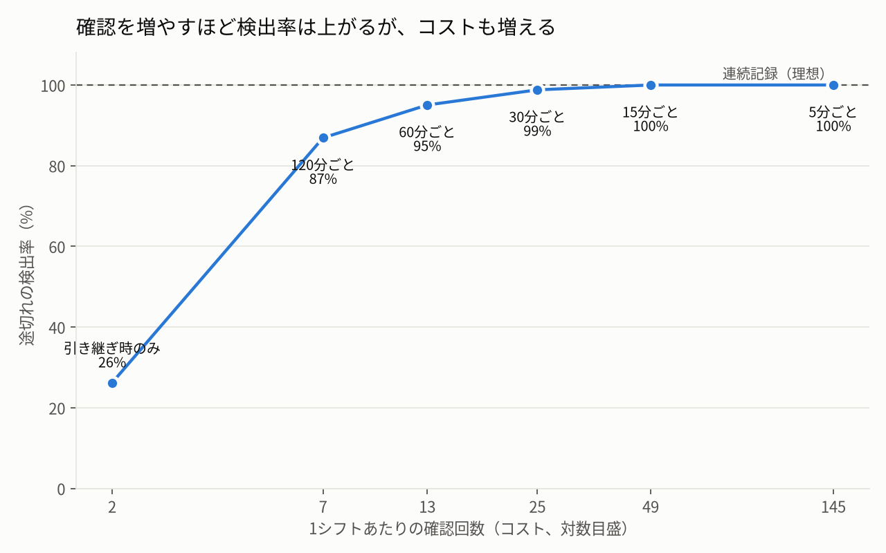
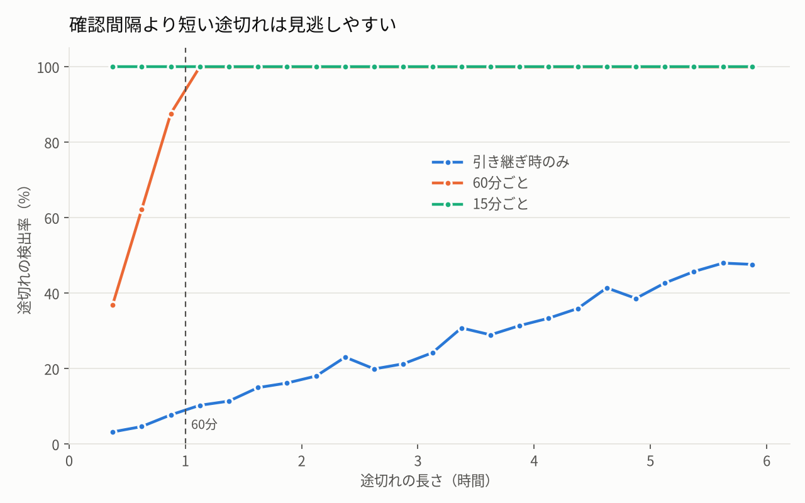

# 点の確認と線の確認 — 確認間隔と見逃しのシミュレーション

「引き継ぎのときだけ確認する」運用では、シフトの途中で起きて途中で元に戻った異常を見逃します。このリポジトリは、確認の間隔を変えたときに異常の検出率と確認コストがどう変わるかを、単純なモデルで示すシミュレーションです。

記事「[点の確認と線の確認 — 人は間違える前提のHITL設計](https://zenn.dev/shisei_kbrg322/articles/7eaabc919a5cb1)」の補足として作りました。

## 結果

既定値（20,000シフト、1シフト12時間、途切れの長さ15分〜6時間）での結果です。

| 確認方法 | 1シフトの確認回数 | 検出率 | 検出までの時間（中央値） |
| --- | ---: | ---: | ---: |
| 引き継ぎ時のみ | 2 | 26.2% | 107分 |
| 120分ごと | 7 | 86.9% | 54分 |
| 60分ごと | 13 | 95.0% | 29分 |
| 30分ごと | 25 | 98.8% | 15分 |
| 15分ごと | 49 | 100.0% | 7分 |
| 5分ごと | 145 | 100.0% | 3分 |



- 引き継ぎ時の確認だけでは、途切れの約4分の3を見逃します。検出できるのは、途切れが引き継ぎの時刻まで続いた場合だけです。
- 確認を増やすと検出率は上がりますが、ある程度から先は確認回数を増やしても得られる改善がわずかになります。



- 確認間隔より短い途切れは見逃しやすく、間隔より長い途切れは確実に検出できます。
- 確認の頻度は「見逃したくない異常の長さ」から逆算して決める設計項目です。

## AIのHuman in the Loopへの示唆

人がAIの出力を確認するのが承認時や定期レビュー時だけなら、その間に起きて元に戻った精度低下は記録に残りません。

- 「今正しいか」だけでなく「途中でおかしくならなかったか」を見る指標を持つ
- 見逃したくない現象の長さから、評価やモニタリングの頻度を決める
- 人が見ていない時間は、自動の連続記録で補う

## 実行方法

### Docker Compose（おすすめ）

手元の Python 環境にライブラリを入れずに実行できます。

```bash
docker compose run --rm sim
```

結果は `outputs/` に保存されます（`results.csv`, `tradeoff.png`, `by_duration.png`）。

条件を変えて試せます。

```bash
docker compose run --rm sim --shift-hours 8 --max-outage 3   # 8時間シフト、途切れは最長3時間
docker compose run --rm sim --trials 100000 --seed 1         # 試行回数と乱数シードを変更
```

### Python で直接実行

```bash
python -m venv .venv
source .venv/bin/activate        # Windows: .venv\Scripts\activate
pip install -r requirements.txt
python simulate.py
```

| オプション | 既定値 | 内容 |
| --- | --- | --- |
| `--trials` | 20000 | シミュレーションするシフト数 |
| `--shift-hours` | 12 | 1シフトの長さ（時間） |
| `--min-outage` | 0.25 | 途切れの最短時間（時間） |
| `--max-outage` | 6 | 途切れの最長時間（時間） |
| `--seed` | 42 | 乱数シード |
| `--out` | outputs | 出力フォルダ |

## モデルの前提と限界

- 各シフトで、監視対象が1回だけ途切れるとしています。
- 途切れの開始時刻と長さは一様乱数です。実際の分布は対象によって異なります。
- 確認は一瞬で終わり、確認する人の見落としはないとしています。実際には人の見落としが加わるため、検出率はこれより下がります。
- 確認コストは確認回数で近似しています。

## ファイル構成

```
simulate.py      シミュレーション本体（numpy）
plot.py          グラフ描画（matplotlib）
Dockerfile       実行環境（Python 3.12 + 日本語フォント）
compose.yaml     Docker Compose の設定
outputs/         実行結果
```

## ライセンス

MIT
